  <a href="https://riizuki.github.io">Portfolio</a>&nbsp;&nbsp;/&nbsp;&nbsp;<a href="https://www.linkedin.com/in/rizkyalfaridhafizh">LinkedIn</a>

  &nbsp;
  &nbsp;
  &nbsp;
  &nbsp;
  &nbsp;
  &nbsp;
  &nbsp;
  &nbsp;
  

